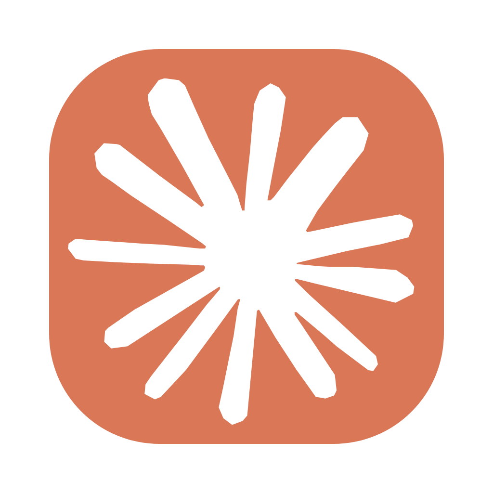

# dsh-claude-harness

One package for the whole "make DeepSeek Harness look like Claude" job on macOS.



| Piece | Delivered by |
| --- | --- |
| Claude Code style UI | `dsh-claude-style` (declared dependency; installed together) |
| Claude app icon | this package — `assets/Claude.icns` → `Contents/Resources/icon.icns` |
| App name "Claude Harness" | this package — `CFBundleName` / `CFBundleDisplayName` + the `.app` filename |

Loading the plugin never changes the app by itself. Branding is opt-in (`apply`),
because a half-applied code signature is what makes macOS kill the app on launch.

## Install

Into a DSH profile — from GitHub:

```bash
cd ~/.dsh/profiles/desktop          # or your profile dir
npm install "github:Yesyugao/dsh-claude-harness" dsh-claude-style
```

or from a local checkout:

```bash
npm install "link:/path/to/dsh-claude-harness" dsh-claude-style
```

Then add both ids to `dsh.profile.bundles` in the profile's `package.json`:

```json
{ "dsh": { "profile": { "bundles": ["...", "dsh-claude-style", "dsh-claude-harness"] } } }
```

Restart the app afterwards — plugin rows are read at startup.

## Use

```bash
dsh-claude-harness status            # what the bundle looks like right now
dsh-claude-harness apply             # icon + name, re-sign, rename (idempotent)
dsh-claude-harness restore           # put the original icon/name back
dsh-claude-harness apply --app /Applications/DeepSeek\ Harness.app --json
```

The same three operations are on the local web server, so the app can call them:

```
GET  /dsh-claude-harness/status
POST /dsh-claude-harness/apply
POST /dsh-claude-harness/restore
```

Run `dsh-claude-harness apply` again after every app update: an update replaces the
bundle, so the icon and the name come back as DeepSeek.

## What `apply` does, in order

1. refuses anything whose `CFBundleIdentifier` is not `com.deepseek.dsh`;
2. backs up `Info.plist` + `icon.icns` to `~/.dsh/dsh-claude-harness/backup/`;
3. installs `assets/Claude.icns`;
4. sets `CFBundleName` / `CFBundleDisplayName` to `Claude Harness`;
5. re-signs ad-hoc, **top level only** (`codesign --force --sign -`;
   `--deep` fails on the running helper subcomponents with "Operation not permitted");
6. renames the bundle to `Claude Harness.app` **last**, then refreshes LaunchServices
   and verifies `codesign --verify` passes.

Steps 3–5 are skipped when the values already match, so re-running is cheap.

## 中文衬线体

`dsh-claude-style` 的衬线字体栈以 `"Anthropic Serif Web Text","Claude Style Noto Serif"` 开头，但这两个族名都没有汉字字形（插件自带的 Noto Serif 是 802 字形的拉丁子集），所以汉字会一路回退到栈尾的 `"Noto Sans SC","PingFang SC"` —— 衬线标题里的中文全成了黑体。

插件的浏览器半边（`lib/client.js`，随本包一起加载）给栈里第一个族名补了一个**只覆盖汉字**的 `@font-face`：

```css
@font-face{font-family:"Anthropic Serif Web Text";
  src:local("Songti SC"),local("Noto Serif SC"),local("Source Han Serif SC");
  unicode-range:U+3000-303F,U+3400-4DBF,U+4E00-9FFF,U+F900-FAFF,U+FF00-FFEF,U+20000-2FA1F}
```

汉字走系统宋体，拉丁字母仍由 Anthropic Serif 出图，两边互不打扰。不装 Anthropic 字体也照样生效（栈里第一个族名没有可用字形时，浏览器继续找同族的下一张 face）。

## Notes

- macOS only (`os: ["darwin"]`), Node ≥ 22.6.
- 字体设置选「跟随宿主」时字体栈只有 `--dsw-font-family`（无衬线），中文衬线体补丁不介入。
- Ad-hoc re-signing resets TCC grants; macOS may ask again for folder access.
- `restore` puts back the plist/icon/name from the backup, not a different app version.
- The icon: 1024×1024 squircle, `#D97757`, with the Claude mark centred by pixel
  centroid. Source `assets/icon.html` → `assets/Claude.icns`.
- Check: `npm test` — `test/branding.test.mjs` builds a throwaway fake bundle and
  exercises apply → no-op → restore against the real `codesign`;
  `test/routes.test.mjs` drives the HTTP handler with a mock request/response;
  `test/client.test.mjs` runs the browser half against a minimal DOM stub.

## License

MIT — see [LICENSE](LICENSE). The icon artwork follows the Claude brand assets; the
Claude Code style UI comes from [dsh-claude-style](https://github.com/Nwflower/dsh-claude-style).
